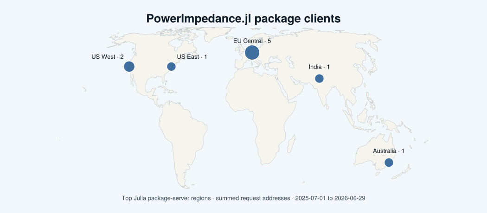

```@meta
CurrentModule = PowerImpedance
```

# PowerImpedance.jl

PowerImpedance models AC, DC, and hybrid power systems for frequency-domain
analysis. Build a network from component models, calculate its operating point
when needed, and inspect impedance or small-signal stability results.

## Install

Add the package with Julia's package manager:

```julia
pkg> add PowerImpedance
```

Load it in Julia with:

```julia
using PowerImpedance
```

## Your first analysis

Follow the [Getting started tutorial](examples/Getting_started_SMIB.md) to
calculate an operating point for a single-machine infinite-bus system. The
example also displays the network and plots impedance and Nyquist results.

## Find a guide

- [Component definitions and inputs](components.md) explains how to choose models and set their values.
- Component guides: [voltage sources](source.md), [lumped impedances](impedance.md),
  [transformers](transformer.md), [lines and cables](transmission_line.md),
  [machines](machines.md), [MMC](MMC.md), [two-level converter](TLC.md), and
  [black-box models](blackbox.md).
- [Network construction](network.md) explains buses, individual nets, and diagrams.
- [Power-flow initialization](initialization.md) explains when an operating point is needed.
- [Impedance and stability analysis](results.md) covers calculations, result objects, and plots.
- [Parametric and uncertainty studies](gridspace.md) covers deterministic and Monte Carlo studies.
- [Examples](examples/index.md) contains larger executable workflows.
- [API reference](reference.md) lists public functions and types.

Optional integrations and plotting backends are described in [Package extensions](package_extensions.md).

## Capabilities

Models include voltage sources, impedances, transformers, lines and cables,
converters, synchronous and induction machines, and black-box responses.
Analyses include impedance, admittance, Nyquist, Bode, passivity, small-gain,
stability-margin, unstable-frequency, and eigenvalue calculations.

The theoretical background retained from the original package documentation is
cited in the project [bibliography](bibliography.md).

## User statistics



The map shows PowerImpedance users by region, from Julia's public package-server
request logs. CI generates it by summing `request_addrs` for requests marked as
user traffic and selecting the top server regions.
