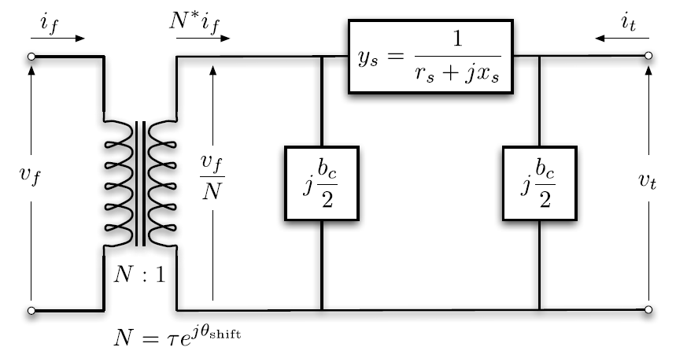
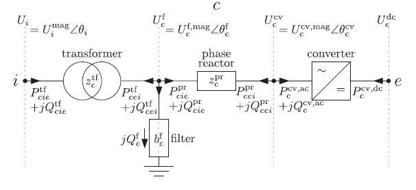

```@meta
CurrentModule = PowerImpedance
```

# Power-flow initialization

Frequency-domain converter and machine models are linearized around a
steady-state operating point. PowerImpedance obtains that operating point
from the combined AC/DC power-flow model and passes physical per-port values
to the detailed active-device models.

The package maps the constructed network to PowerModels and PowerModelsACDC
data structures. Those formulations build on the MATPOWER and MatACDC network
models [Ergun2019, Beerten2012, ZimmermanMurillo2020](@cite).

## Branch equivalents

Balanced AC branches use the standard ``\pi`` equivalent. With series
admittance ``y_s``, shunt conductance ``g_c``, shunt susceptance ``b_c``, tap
ratio ``\tau``, and phase shift ``\theta_{\mathrm{shift}}``, the branch
admittance is

```math
\mathbf{Y}_{ac} =
\begin{bmatrix}
\left(y_s+\frac{g_c}{2}+\mathrm{j}\frac{b_c}{2}\right)\tau^{-2} &
-\dfrac{y_s}{\tau\exp(-\mathrm{j}\theta_{\mathrm{shift}})} \\
-\dfrac{y_s}{\tau\exp(-\mathrm{j}\theta_{\mathrm{shift}})} &
y_s+\dfrac{g_c}{2}+\mathrm{j}\dfrac{b_c}{2}
\end{bmatrix}.
```



Detailed impedance, transformer, overhead-line, and cable objects are reduced
to the equivalent branch quantities required at the fundamental frequency.
Their full frequency-dependent models remain available to the later impedance
and small-signal calculations.

## Converter equivalents

A power-flow converter contains its AC and DC terminals, series reactor, loss
model, and control mode. Depending on its configured references, it regulates DC voltage or
active power together with its selected AC-side quantity.



Once power flow is solved, the operating point is used for the nonlinear
equilibrium and active-device linearization. Power-flow warnings refer to the sampled physical converter and its constraints, not to an
aggregated uncertain model.

## Calculated operating point

`compute(PowerFlowProblem(state), ACDCPowerFlow())` always solves the requested
network, including networks with only sources and passive components.
`NetworkBuilder.solve(state)` returns the resulting `PowerFlowResult`.
Its `result`, `data`, `nodes2bus`, and `elem2comp` fields retain the solution,
converted data and mappings. Repeated solves use the state's converged primal
starting values.

The `operating_point` field is an `OperatingPoint` indexed by component and port
name. Each non-passive component has a NamedTuple of `ACPortValues` or
`DCPortValues`. For a converter named `c1`, read `point[:c1].ac.p` and
`point[:c1].dc.v`. AC voltage is phase peak in kV. DC voltage is pole to pole in kV. Angles are in rad, active power in MW, and reactive power in MVAr.

All port powers are positive into the component. A source delivering 900 MW has
`ac.p = -900`. A motor drawing 916 MW has `ac.p = 916`. A converter taking
603 MW from DC and delivering 600 MW to AC has `dc.p = 603` and `ac.p = -600`.

`compute(LinearizationProblem(state, powerflow), AdmittanceLinearization())`
uses that exact result and returns a `LinearizationResult`. Its `network_model`
contains the frequency-domain `NetworkModel`. Its `operating_point` records
the values used for active admittances. Without a supplied result, power flow
is calculated before the nonlinear models are linearized. A network of linear
models instead uses an empty operating point for linearization alone.

For one state-space model, `linearize(model, values)` takes a NamedTuple keyed
by port and computes `A, B, C, D`. `steady_state(model, values)` returns the
converged state, reusing it when cached port values compare equal with `isequal`.
A configured copy made with `withinputs` has a fresh cache.

## References and power-flow seeds

Control-loop references and converter or machine power-flow seeds use per-unit
values on `bases(model)`. Source inputs and scan-based MMC inputs use physical
units. `inputs(model)` lists defaults, units, declared types and descriptions.
`inputvalues(model)` lists configured values.

For a converter, the selected loops supply their controlled quantities:

| Quantity | Input supplying the reference |
|:--|:--|
| AC active power | `OuterActivePowerControl.p_ref` or `VSEWithDamping.p_ref` |
| DC voltage | `OuterActiveVdcControl.v_dc_ref` or `DCVoltageSupportLag.v_dc_ref` |
| AC reactive power | `OuterReactiveQControl.q_ref` |
| AC voltage | `OuterReactiveVacControl.v_ac_ref` or `VoltageSupportLag.v_ac_ref` |
| DC power | `powerflow.p_dc` |

Uncontrolled quantities use the `powerflow` group. Setting a seed for a quantity
already controlled by a loop warns. The loop reference is used. Converter
`powerflow.p_dc` is positive into the DC port. Detailed control equations are
initialized from the solved port values.

Synchronous-machine inputs include `avr.v_ref` and the `powerflow` group
`(p, q, v)`. An induction machine has no declared inputs. Its mechanical torque
sets its power-flow loading. `NaN` reactive power in manually supplied AC port
values selects the configured AVR reference for synchronous-machine initialization.

## Reuse in parametric studies

Every materialized configuration performs its own required power flow before
linearization. Passive parameters can change solved voltages and powers.

An explicit `preprocess` call can pair completed parametric `PowerFlowResult`
values with their originating configurations. This reuses only those exact
results. Each Monte Carlo trial samples a complete numeric network before
calling the power-flow solver. Supported bus-level `Measurement` values are
reconstructed after the numeric solves.
