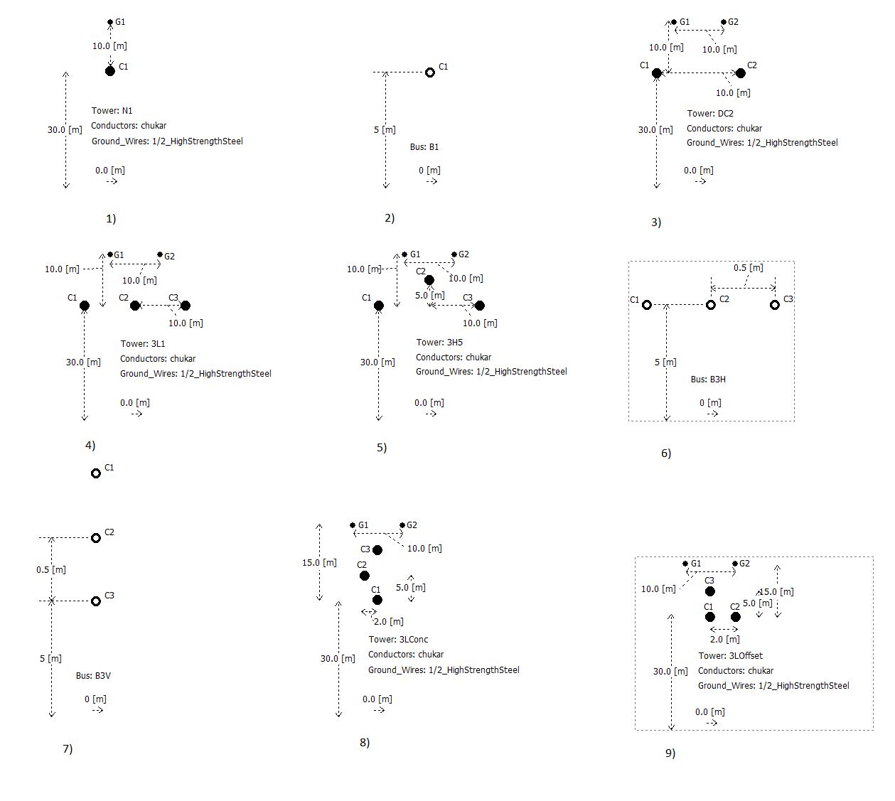
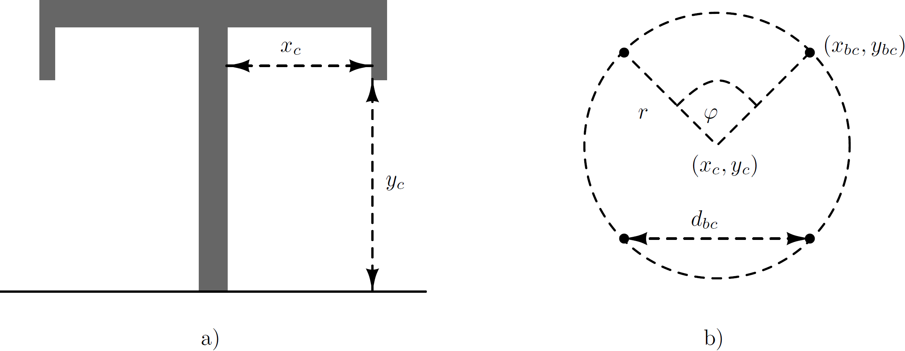
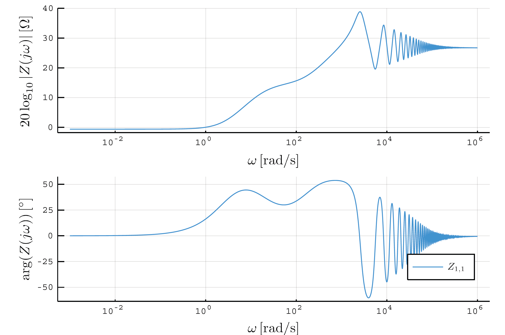

```@meta
CurrentModule = PowerImpedance
```

# Transmission lines and cables

Choose `overhead_line` for geometry-based overhead lines, `cable` for layered
buried cables, or `blackbox_line` for imported frequency-response data. These
models use `side1` and `side2` ports. The executable
[line and cable example](examples/Line_and_cable_models.md) shows native AC and
DC line construction, cable layers, and impedance plots.

Use `Conductors` and `Groundwires` to describe an overhead line's phase bundles
and earth return. A cable uses ordered `Conductor` and `Insulator` layers plus
its burial positions. See [Black-box models](blackbox.md) for imported data.

PowerImpedance evaluates overhead-line and cable series impedance
``\mathbf{Z}(f)`` and shunt admittance ``\mathbf{Y}(f)`` in phase coordinates,
then forms the distributed-parameter transmission-line ABCD model
[CastellanosMarti1997, MorchedGustavsenTartibi1999](@cite):

```math
\begin{bmatrix}
\mathbf{A} & \mathbf{B} \\
\mathbf{C} & \mathbf{D}
\end{bmatrix}
=
\begin{bmatrix}
\cosh(\mathbf{\Gamma}l) &
\mathbf{\Gamma}^{-1}\sinh(\mathbf{\Gamma}l)\mathbf{Z} \\
\mathbf{Y}_c\sinh(\mathbf{\Gamma}l) &
\mathbf{Z}^{-1}\cosh(\mathbf{\Gamma}l)\mathbf{Z}
\end{bmatrix},
```

where ``\mathbf{\Gamma}=\sqrt{\mathbf{Z}\mathbf{Y}}``,
``\mathbf{Y}_c=\mathbf{Z}^{-1}\mathbf{\Gamma}``, and ``l`` is the line
length. Matrix products retain the displayed order for untransposed geometries.

## Overhead lines

An overhead line comprises phase conductors, optional ground wires, and
an earth-return model. Conductors can be arranged in flat, vertical, delta,
offset, or concentric organizations, or supplied through explicit positions.
Bundle geometry, sag correction, conductor resistance and radius, ground-wire
data, and earth properties determine the full self and mutual parameter
matrices [MartinezVelasco2017](@cite).





The complete matrices, including mutual terms, are retained through line
evaluation. Line constructors return models with `side1` and `side2` ports.
Three-conductor lines declare `ACABC`. Connecting them to an `ACDQ` bus selects
the dq transform. Two-conductor lines declare one `DC_CM` differential port
per end.

## Underground cables

A cable group contains coaxial conducting and insulating layers at specified
burial positions. The implemented native geometry supports core, sheath, and
armor and screen arrangements, layer material properties, and earth-return mutual
coupling. Internal grounded layers can be eliminated by Kron reduction to
obtain a compact terminal model [Ametani1980, RivasMarti2002](@cite).

Cable models also use `side1` and `side2`. A cable with three retained conductors uses
`ACABC`. A cable with two uses one differential `DC_CM` port per end. The same port
names apply to `blackbox_line` models imported from Z/Y data.



## LineCableModels interoperability

LineCableModels interoperability is temporarily dormant while
LineCableModels.jl awaits registration. Native line constructors remain
available. The compatibility extension and its tests will be restored once
LineCableModels can be declared as a registered weak dependency.

See [`overhead_line`](@ref), [`cable`](@ref), [`Conductors`](@ref),
[`Groundwires`](@ref), [`Conductor`](@ref), and [`Insulator`](@ref) for the
current native constructors.
